<div align="center">

<a href="https://vibrantlearn.vercel.app"></a>

<a href="https://vibrantlearn.vercel.app"></a>

[](https://vibrantlearn.vercel.app)
[](https://vibrantlearn-api.vercel.app/api/v1/health)


**An AI-powered personalised learning path generator with live classes, built for Indian college students.**<br>
Built by **Bipin A** and **Darshan H.S.**, BCA, KLE Society's S. Nijalingappa College, Bengaluru (Bengaluru City University).

[**Open the app**](https://vibrantlearn.vercel.app) · [Features](#-what-it-does) · [Screens](#-screens) · [How it works](#-how-it-works) · [Run it](#-run-it-locally) · [Docs](#-documentation)

</div>

---

## 💡 The problem

The night before an internal, most students open five tabs, a WhatsApp PDF and a YouTube playlist, and still don't know what to study first. Help in Kannada or Hindi is rare, and good teachers are hard to reach in the evening.

**VibrantLearn** turns one sentence, such as *"Java internal tomorrow 10 AM, BCA SEP, Kannada, quizzes"*, or the student's own notes into a plan they can actually finish. It also connects them with verified college teachers for small evening live classes.

## ✨ What it does

<table>
<tr>
<td width="50%" valign="top">

### 🎓 For students
- **Timed study plan:** blocks and checkpoints that fit the hours left, weak topics first, nights kept free.
- **Notes, likely questions, quizzes, flashcards**, all following the BCU syllabus.
- **Ask your notes:** upload PDFs or slides and get answers that cite the page.
- **Your language:** English, Kannada, Hindi, and Kanglish or Hinglish typed in English letters.
- **Rewards:** points, streaks and badges for steady study, plus an opt-in leaderboard.
- **Live classes:** mark *Interested*; interested students get the first seats.

</td>
<td width="50%" valign="top">

### 🧑‍🏫 For teachers
- **Create a room in seconds:** Start now, In 30 min, Tonight or Tomorrow, then copy the class link.
- **Demand board:** what students want tonight, shown only for groups of 5 or more.
- **Earnings strip:** this month, pending, paid and next payout, with a clear statement.
- **Attendance and after-class summary**, ratings, and a public profile.
- **Account health** with warnings, reviews and an appeal process.
- **Onboarding** with a questionnaire and certificate check.

</td>
</tr>
</table>

<details>
<summary><b>🛡️ The moderation bot: what it catches</b></summary>
<br>

Every class chat message is checked before anyone else sees it, in English, Kannada, Hindi, Kanglish and Hinglish, including disguised spellings.

| Category | Action |
|---|---|
| Abuse, sexual content, hate, threats | Hidden and counted as a warning |
| Phone numbers, e-mails, social handles | Hidden (teachers may share links) |
| "Maybe rude" (e.g. *stupid*, *useless*) | Checked by the language model. If it is unsure or unavailable, the message is allowed |
| 3 warnings in a class | The user is removed and gets one account-level warning |

</details>

<details>
<summary><b>📏 Live class rules</b></summary>
<br>

| Rule | Value |
|---|---|
| Seats per class | 10 minimum to run, 40 maximum |
| Who gets a seat | Interested students first; open seats after a **2-minute** grace period |
| Not enough students | The class is cancelled automatically |
| Teacher no-show | Warning after **10 minutes** |
| Price | ₹2,000 per class with a 20% platform fee, so the teacher gets **₹1,600** |
| Video | Private Jitsi room per class, no login needed |

</details>

## 🖼️ Screens

<table>
<tr>
<td>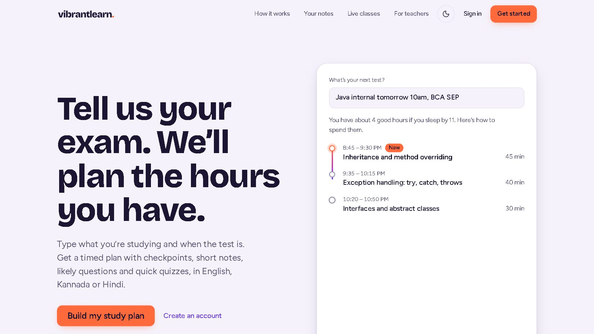</td>
<td>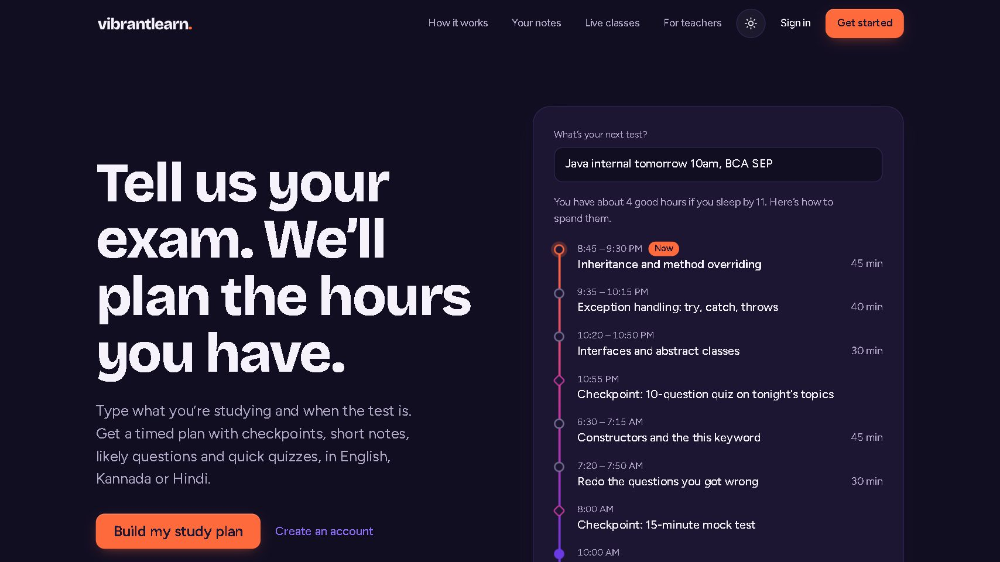</td>
</tr>
<tr>
<td align="center"><sub>Landing: the plan builds itself as you watch</sub></td>
<td align="center"><sub>Dark theme</sub></td>
</tr>
<tr>
<td>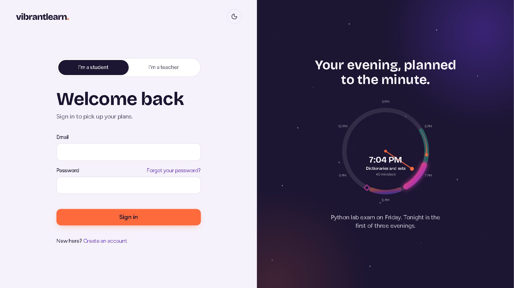</td>
<td>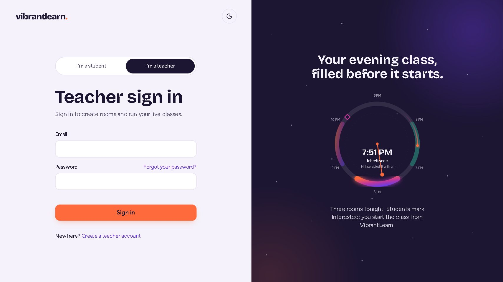</td>
</tr>
<tr>
<td align="center"><sub>Student sign-in with the living evening dial</sub></td>
<td align="center"><sub>One switch slides between student and teacher</sub></td>
</tr>
<tr>
<td>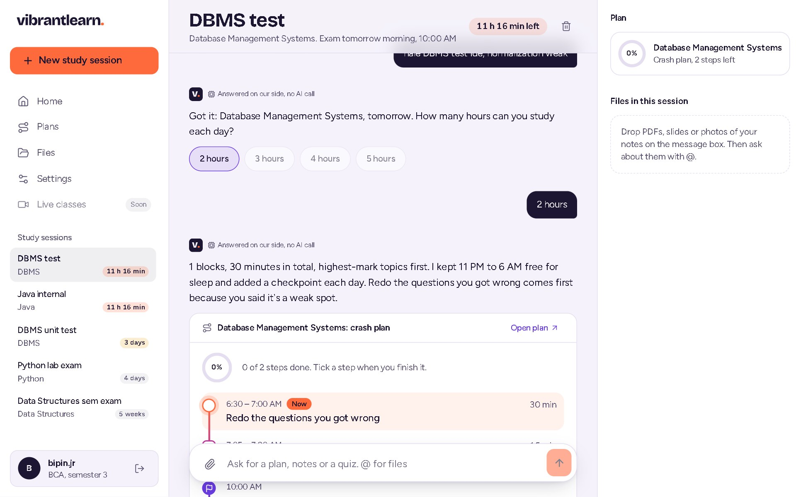</td>
<td>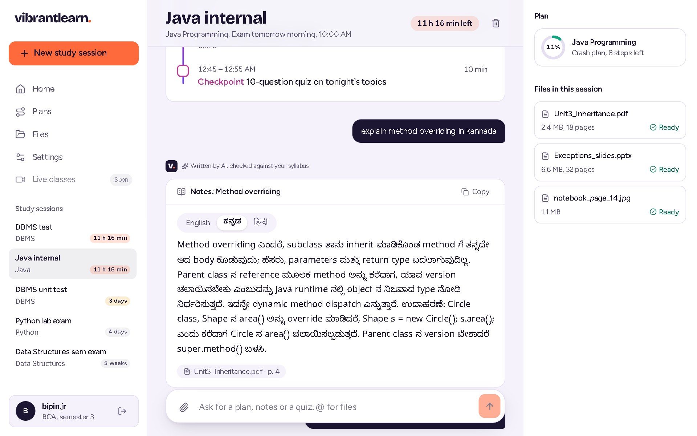</td>
</tr>
<tr>
<td align="center"><sub>A generated plan with checkpoints</sub></td>
<td align="center"><sub>Notes in Kannada</sub></td>
</tr>
<tr>
<td>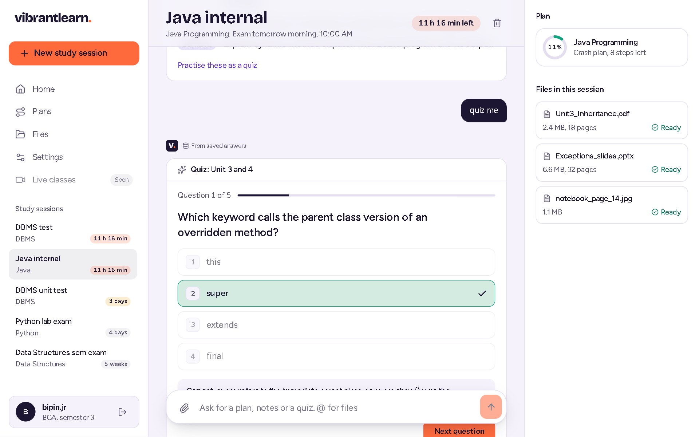</td>
<td>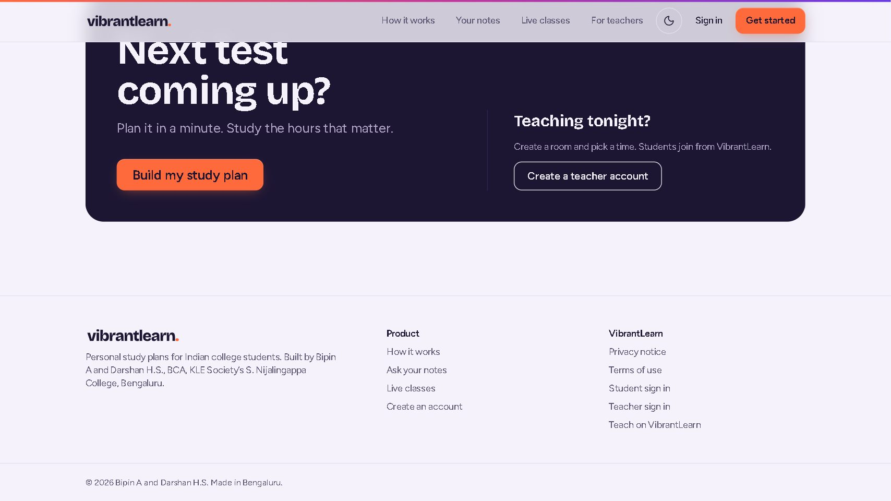</td>
</tr>
<tr>
<td align="center"><sub>Quizzes are graded on the server</sub></td>
<td align="center"><sub>Students plan, teachers teach tonight</sub></td>
</tr>
</table>

<p align="center">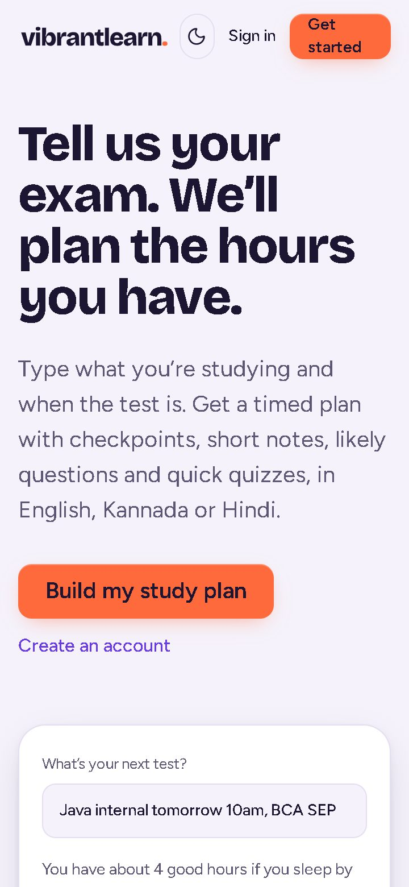</p>

## 🧠 How it works

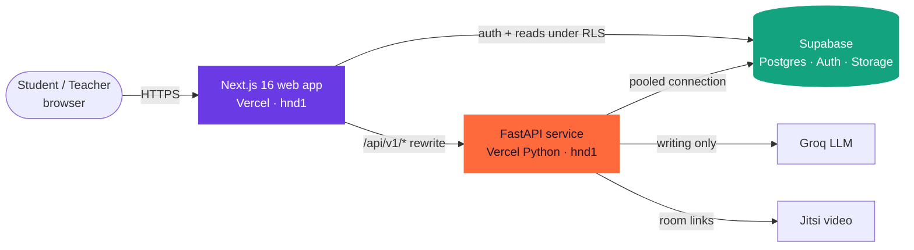

**Local ML first, AI only where writing is needed.** Every study request goes through this pipeline before any language-model call:

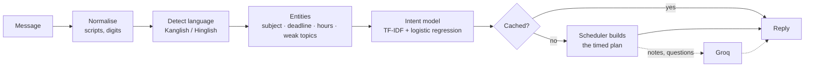

| Piece | What it does |
|---|---|
| **Intent model** | TF-IDF (word + character) with logistic regression, trained on 765 labelled requests. Holdout accuracy 0.75; rules handle the clear cases |
| **Scheduler** | Builds blocks from the BCU syllabus by weightage and difficulty. Weak topics first, 11 PM to 6 AM kept free |
| **Groq** | Writes notes, questions, quizzes and flashcards only. Results are cached, and quiz answer keys never reach the browser |
| **Ask your notes** | Checks the real file type, extracts and chunks the text, and retrieves passages with page references |
| **Moderation** | A local filter decides the clear cases; only unclear ones go to the language model |

## 🔐 Security and privacy

- **Row-level security on every table.** The database itself refuses to show one student's data to anyone else. **64 pgTAP checks** prove it, including that teachers can never read a student's study data.
- **The server makes the rules:** seat decisions, quiz grading, moderation and payouts all happen in the API, never in the browser.
- **No secrets in the browser:** only the Supabase publishable key is public. Everything else lives in server-side environment variables.
- **Strict headers:** a nonce-based Content-Security-Policy, HSTS, `nosniff`, `X-Frame-Options: DENY`.
- **Uploads** are checked by their content (file signatures, zip-bomb guard), not by file extension.
- **Rate limits and an audit log** on the API.

## 🎨 Design

| | |
|---|---|
| **Colours** | Ink `#1C1633` · Mist `#F5F2FB` · Ember `#FF6A3D` · Violet `#6A3BE4` · Leaf `#14A37F` · Orchid `#C2389B` |
| **Type** | Bricolage Grotesque (display), Figtree (body), Noto Sans Kannada and Devanagari |
| **Motion** | 90 / 150 / 220 / 320 ms tokens. View transitions between pages, a sliding student/teacher switch, a theme change that spreads from the toggle, scroll reveals. Everything is replaced by a still version when the device asks for reduced motion |
| **Accessibility** | WCAG 2.2 AA contrast on every text pair, keyboard paths, skip links, labelled controls, works at 360 px |

## 🧰 Tech stack

| Layer | Choice |
|---|---|
| Web | Next.js 16 (App Router), React 19, TypeScript strict, Tailwind CSS 4 |
| API | Python 3.12, FastAPI, Pydantic v2, psycopg 3 with a connection pool |
| Data | Supabase: Postgres with RLS, Auth, private Storage buckets |
| ML / AI | scikit-learn, rapidfuzz, yake · Groq (`gpt-oss-20b` / `gpt-oss-120b`) |
| Video | Jitsi (community server, no host login) |
| Hosting | One GitHub repo, two Vercel projects (`apps/web`, `apps/api`) in Tokyo, next to the database |
| Tests | Vitest + Testing Library, Playwright, pytest, pgTAP |

## ✅ Quality

| Suite | Tool | Count |
|---|---|---|
| Web components and logic | Vitest | **158** |
| API services and routes | pytest | **252** |
| Database security | pgTAP | **64** |
| Browser walkthrough | Playwright | 17 steps at 3 screen sizes |
| Live-site checks | Playwright | 26 (pages, sign-in guards, headers, API, 360 px fit) |
| Static checks | ESLint, `tsc`, ruff, `mypy --strict` | clean |

## 🚀 Run it locally

**On the live site:** press **Sign in as the demo student** on [/login](https://vibrantlearn.vercel.app/login) or **Sign in as the demo teacher** on [/teach/login](https://vibrantlearn.vercel.app/teach/login). No password needed.

**Quick local demo (Node.js 20+, no account or database needed):** double-click `START-DEMO.bat` or run `npm run demo`, then press **Try the demo** at http://localhost:3000.

**Full app:**

```bash
# web
cd apps/web && pnpm install && pnpm dev              # http://localhost:3000

# api
cd apps/api && uv sync && uv run uvicorn app.main:app --reload --port 8000
```

<details>
<summary><b>Environment variables (names only; values go in <code>.env</code> files that are never committed)</b></summary>
<br>

| `apps/web/.env.local` | `apps/api/.env` |
|---|---|
| `NEXT_PUBLIC_SUPABASE_URL` | `DATABASE_URL` |
| `NEXT_PUBLIC_SUPABASE_PUBLISHABLE_KEY` | `SUPABASE_URL`, `SUPABASE_JWKS_URL` |
| `NEXT_PUBLIC_SITE_URL` | `SUPABASE_SECRET_KEY` |
| `API_ORIGIN` | `GROQ_API_KEY`, `IP_HASH_SALT` |
| `GROQ_API_KEY` (demo chat) | `VIDEO_BASE_URL`, `MAX_UPLOAD_MB` |
| `DEMO_MODE` (local only) | `TEACHER_AUTO_VERIFY`, `CLASS_MIN_STUDENTS`, `CLASS_MIN_LEAD_MIN` |
| `DEMO_STUDENT_EMAIL` / `_PASSWORD`, `DEMO_TEACHER_EMAIL` / `_PASSWORD` (one-click demo sign-in) | `DEMO_EMAILS` (shared demo accounts can't be deleted) |

Step-by-step setup: [docs/setup/SETUP_SUPABASE.md](docs/setup/SETUP_SUPABASE.md) · [docs/setup/MANUAL_STEPS.md](docs/setup/MANUAL_STEPS.md)

</details>

<details>
<summary><b>Run the checks</b></summary>

```bash
cd apps/web && pnpm lint && pnpm typecheck && pnpm test && pnpm build
cd apps/api && uv run ruff check . && uv run mypy app && uv run pytest -q
supabase test db                                                   # pgTAP security checks
uv run --no-project --with playwright python apps/web/e2e/smoke.py # with the demo running
```

</details>

<details>
<summary><b>Deploy</b></summary>
<br>

Every push to `main` deploys both Vercel projects: **vibrantlearn** (`apps/web`) and **vibrantlearn-api** (`apps/api`). The web app reaches the API through its `/api/v1/*` rewrite. Details and rollback: [docs/ops/DEPLOYMENT.md](docs/ops/DEPLOYMENT.md).

</details>

## 🗂️ Project layout

```
Code/
├── apps/
│   ├── web/                 Next.js app
│   │   ├── app/(marketing)/   landing, terms, privacy
│   │   ├── app/(auth)/        student sign-in, sign-up, password reset
│   │   ├── app/app/           student app: home, sessions, plans, files, classes, rewards, settings
│   │   ├── app/teach/         teacher portal: home, rooms, earnings, profile, settings, health
│   │   ├── app/review/        reviewer queue: teachers, appeals, reports
│   │   ├── components/        UI: plan timeline, quiz, flashcards, class room, evening dial
│   │   └── e2e/               Playwright walkthrough and screenshots
│   └── api/                 FastAPI service
│       ├── app/routers/       thin HTTP layer
│       ├── app/services/      rules: plans, files, quizzes, classes, chat, demand, rewards
│       ├── app/ml/            parser, intent model, scheduler, moderation filter
│       └── app/llm/           Groq client, versioned prompts, cache
├── supabase/                migrations (RLS everywhere), seed, pgTAP tests
├── docs/                    handbook (PRD, security, API, database, frontend), ops, setup
├── brand/                   logo files and brand guide
└── scripts/                 one-click demo launcher
```

## 📚 Documentation

| Read | For |
|---|---|
| [PRD](docs/handbook/PRD.md) · [Roadmap](docs/handbook/ROADMAP.md) · [Teacher spec](docs/handbook/TEACHER.md) | what we build and why |
| [Architecture](docs/handbook/ARCHITECTURE.md) · [API](docs/handbook/API.md) · [Database](docs/handbook/DATABASE.md) | how it fits together |
| [Security](docs/handbook/SECURITY.md) · [Privacy](docs/handbook/PRIVACY.md) | the rules we don't break |
| [Frontend](docs/handbook/FRONTEND.md) · [Accessibility](docs/handbook/ACCESSIBILITY.md) · [Brand](brand/BRAND.md) | how it looks and moves |
| [Testing](docs/handbook/TESTING.md) · [Deployment](docs/ops/DEPLOYMENT.md) · [Runbook](docs/ops/RUNBOOK.md) | shipping and fixing |
| [Feature guide (PDF)](VibrantLearn_Features.pdf) · [Changelog](CHANGELOG.md) · [Contributing](CONTRIBUTING.md) | everything else |

## 👥 Team

| | Role | Owned |
|---|---|---|
| **Bipin A** | Project lead · backend, AI and database | FastAPI service, schema and RLS, ML parser and intent model, Groq content, live-class rules, moderation bot, teacher API, rewards |
| **Darshan H.S.** | Frontend, UX and quality | Design system, landing page, sign-in pages and evening dial, student screens, live-class UI, teacher portal UI, Kannada/Hindi interface, accessibility, tests |

<p align="center"><sub>Project guide: Prof. Preetha Sarathy · Co-ordinator: Prof. Sharada C · BCA, KLE Society's S. Nijalingappa College, Rajajinagar, Bengaluru</sub></p>

<p align="center"><a href="https://vibrantlearn.vercel.app"></a></p>
